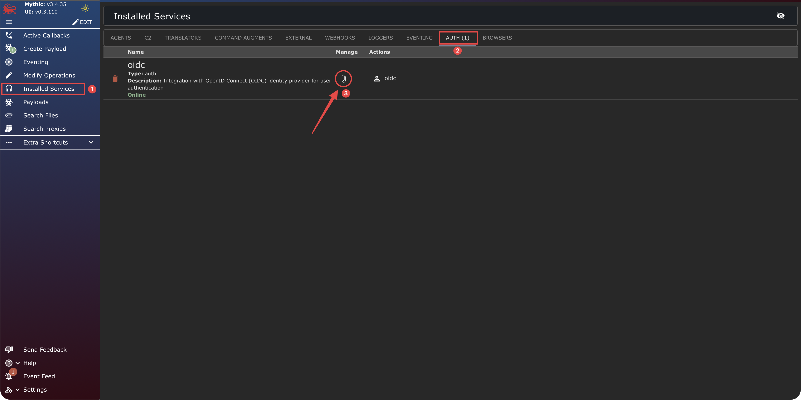
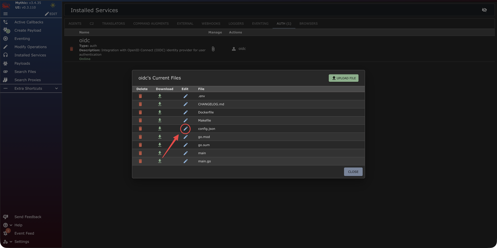
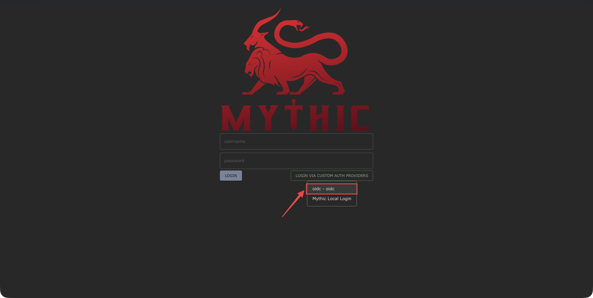

# oidc_auth_provider

oidc_auth_provider is an authentication container that provides support for OpenID Connect (OIDC) authentication to Mythic.

## Installation

```
sudo ./mythic-cli install github https://github.com/MythicC2Profiles/oidc_auth_provider
```

## Configuration

After installing the provider, navigate to Installed Services → AUTH tab, then click the paperclip icon:



Edit `config.json` file:



Example configuration:

```json
{
    "issuer": "https://oidc.example.com",
    "client_id": "<client-id>",
    "client_secret": "<client-secret>",
    "redirect_url": "https://<mythic-domain>:7443/auth_acs/oidc/oidc"
}
```

`issuer` - The base URL of the OpenID Connect provider.  
`client_id` - The unique identifier assigned to your Mythic application by the OIDC provider.  
`client_secret` - A secret key issued alongside the `client_id`.  
`redirect_url` - The callback URL where the OIDC provider will send the user after authentication. Must be `https://<mythic-domain>:7443/auth_acs/oidc/oidc`.  

Once the configuration is saved, users can log in to Mythic via the configured OIDC provider.

> **Note:** The user must already exist in Mythic, and their Mythic email address must match the one registered with the OIDC provider.


